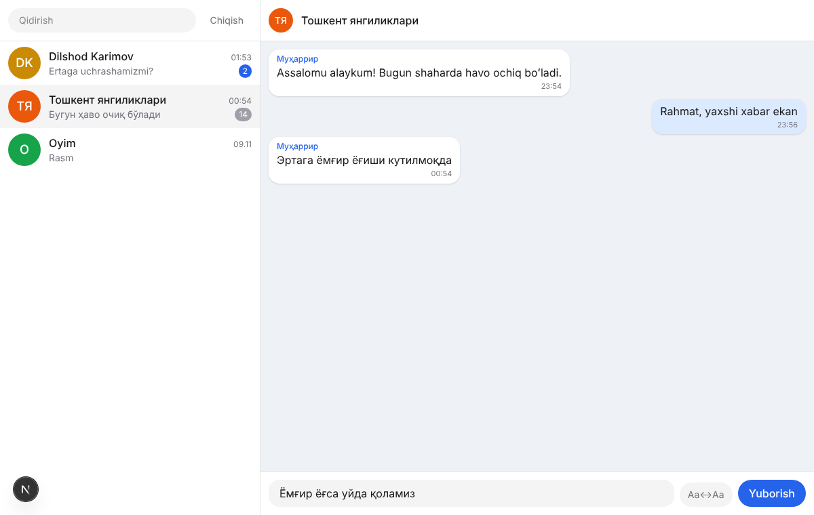

# Tg-crazy

O'zbekiston uchun kuchaytirilgan norasmiy Telegram klienti. Next.js'da yozilgan, to'liq
brauzerda ishlaydi: sessiya faqat qurilmada saqlanadi va to'g'ridan-to'g'ri Telegram
serverlariga ulanadi.

- [Tahlil va reja](docs/PLAN.md) — mashhur Telegram klientlari tahlili, API shartlari, yo'l xaritasi.



## Hozir nima bor

Telegram bilan haqiqiy almashinuv hali sinalmagan — buning uchun `api_id` kerak (pastga qarang).
Interfeys namunaviy ma'lumot bilan, backend esa testlar va lokal server bilan tekshirilgan.

**Messenjer** — to'liq ro'yxat va holat: [docs/UI_FEATURES.md](docs/UI_FEATURES.md)
- Kirish: telefon → kod → ikki bosqichli parol
- Chatlar: Telegram papkalari, arxiv, "Saqlangan xabarlar", qadash, ovozsiz qilish, o'qilgan/o'qilmagan, o'chirish; qoralama va "yozmoqda…" ko'rinishi
- Xabarlar: formatlash (qalin, kursiv, kod, spoiler, iqtibos, havolalar), javob, tahrir, o'chirish, uzatish, reaksiyalar, ovozsiz yuborish
- Media: rasm va albomlar, galereya, video, GIF, dumaloq video, ovozli xabar to'lqini, stikerlar (oddiy/video/animatsiyali), fayllar; yuborish (📎, sudrab tashlash, Ctrl+V)
- So'rovnomalar (ovoz berish), havola prevyusi, joylashuv, kontakt, bot tugmalari
- Suhbat: o'qilmaganlar ajratgichi, qadalgan xabarlar paneli, chat ichida qidiruv, profil paneli (umumiy media, fayllar, havolalar, a'zolar)
- Yozish maydoni: emoji va stiker paneli, Ctrl+B / Ctrl+I, Telegram bilan sinxron qoralamalar
- Global qidiruv (chatlar va xabarlar), brauzer bildirishnomalari, sozlamalar (matn o'lchami, chat foni)

**O'zimizniki**
- Lotin ↔ kirill o'girish: butun chat, alohida xabar yoki yozish maydoni uchun
- AI (backend ulangan bo'lsa): suhbat xulosasi, xabar tarjimasi, javob qoralamasi — har safar nima yuborilishi ko'rsatiladi
- Sozlamalar sinxroni (mavzu, AI tili) qurilmalar orasida
- Mavzu: tizim / och / to'q; mobil ko'rinish

## Ishga tushirish

1. <https://my.telegram.org> → *API development tools* da ilova yarating, `api_id` va `api_hash` oling.
2. Sozlang va ishga tushiring:

   ```bash
   cp .env.example .env.local   # api_id va api_hash ni to'ldiring
   npm install
   npm run dev                  # http://localhost:3000
   ```

Backend ixtiyoriy (AI, obuna, sozlamalar sinxroni) — [backend/README.md](backend/README.md).
Ishga tushirgach, `.env.local` ga `NEXT_PUBLIC_API_URL=http://localhost:8080` qo'shing.

## Buyruqlar

| Buyruq | Vazifasi |
|---|---|
| `npm run dev` | Ishlab chiqish serveri |
| `npm run build` | Statik build → `out/` |
| `npm run lint` / `npm run typecheck` / `npm test` | Tekshiruvlar |

## Tuzilma

- `src/lib/telegram/` — Telegram bilan ishlash (`@mtcute/web`); kutubxona faqat shu yerda ishlatiladi
- `src/lib/translit/` — lotin ↔ kirill
- `src/lib/backend/` — Tg-crazy backend klienti
- `src/store/` — ilova holati (Zustand): `app.ts` — messenjer, `services.ts` — backend xizmatlari
- `src/components/` — interfeys
- `backend/` — Go xizmati (akkaunt/obuna, AI, sozlamalar)
